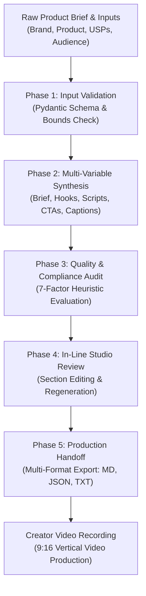

# Campaign Operational Workflow & Architecture

> **Project:** Future Interns — Task 2: AI Content Marketing Using UGC Ads  
> **Repository:** `FUTURE_PE_02`  
> **Author & Intern:** Sangeetha S  
> **Application:** PromptAdsCraft AI Creative Studio  

---

## 1. End-to-End Operational Workflow

The generation and production lifecycle of a UGC advertising campaign follows a 5-phase sequential pipeline designed to convert raw product details into verified, production-ready creative assets:

---

## 2. Phase-by-Phase Technical Breakdown

### Phase 1: Input Ingestion & Data Hygiene
- **User Actions:** The marketer, founder, or agency strategist inputs the brand name, product name, raw description, target audience, primary benefits, campaign objective, tone, and forbidden words.
- **System Action:** Inputs pass through `src/validators.py` utilizing strict Pydantic v2 schemas.
- **Validation Checks:**
  - Length bounding (Brand name 1–100 chars, Description 1–1000 chars, etc.).
  - Durations restricted to valid video increments (15s, 30s, 60s).
  - Tones validated against the supported psychological matrix (Friendly, Humorous, Educational, Energetic, Professional, Premium).
  - Sanitization of malformed characters.

---

### Phase 2: Multi-Variable Prompt Synthesis
- **System Action:** Validated inputs are fed into the **Multi-Variable Synthesis Engine** (`src/synthesis_engine.py`).
- **Parallel Synthesis Pipelines:**
  1. **Strategic Brief Generation:** Distills core messages and flags claims for human review.
  2. **Hook Engine:** Synthesizes 10 varied hooks across 7 psychological categories.
  3. **Script Orchestrator:** Structures scene-by-scene 9:16 vertical video scripts following `PROBLEM → SOLUTION → BENEFIT → CTA`.
  4. **CTA Categorizer:** Produces funneled CTAs (Purchase, Discovery, Website, Engagement).
  5. **Caption & Tag Generator:** Produces 4 caption variants and a 3-tier non-spammy hashtag matrix.
  6. **Platform Adapter:** Tailors creative packages for Instagram Reels, YouTube Shorts, and Paid Social Ads.

---

### Phase 3: Automated Quality & Compliance Audit
- **System Action:** All generated assets are evaluated by `src/quality_checker.py`.
- **Heuristic Dimensions Scored (0–100 Scale):**
  - Audience Relevance
  - Message Clarity
  - Hook Distinctiveness
  - CTA Relevance
  - Platform Suitability
  - Claim Verification
  - Testimonial Language Safety
- **Transparency Safeguard:** The audit automatically appends an explicit score disclaimer: *"These scores are heuristic content quality estimates, not predictions of actual advertising performance."*

---

### Phase 4: In-Line Studio Review & Refinement
- **User Actions:** In the **Campaign Results** studio view, the user can:
  - Inspect generated scenes and on-screen text overlays.
  - Edit copy in-line directly within the interface.
  - Regenerate individual sections (e.g., regenerate hooks only) without re-running the entire campaign pipeline.
  - Review flagged claims that require legal or laboratory verification.

---

### Phase 5: Multi-Format Export & Creator Handoff
- **System Action:** Assets are serialized via `src/exporters.py` into three industry-standard formats:
  - **Formatted Markdown (`.md`):** Complete with headings, markdown tables, and shot lists for easy reading and GitHub publishing.
  - **Structured JSON (`.json`):** Machine-readable payload for programmatic CMS import or media agency databases.
  - **Plain Text (`.txt`):** Formatted for direct copy-paste into creator brief DMs, Notion boards, or teleprompter applications.
- **Local Persistence:** The campaign is committed to `campaigns.json` via `src/storage.py`, maintaining full audit trails and timestamped version history.
